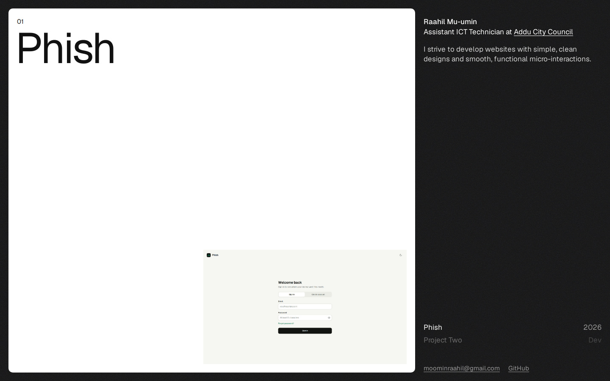

# Portfolio

My personal site. It's just plain HTML, CSS and JavaScript, no framework and no build step.

Open the menu to see the projects I've worked on. Hover one and you get a quick preview of it.

To add a project, put a screenshot in `assets/images/` and add an entry to the `projects` list at the top of `script.js`.

Live at https://port-nu-two.vercel.app

